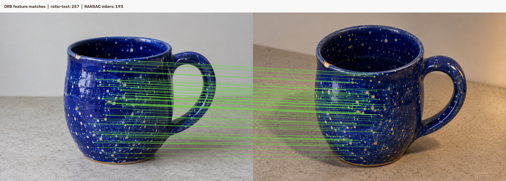

# Cup Feature Matching

This computer vision exercise matches two original images of the same speckled blue mug. The second view changes the camera angle and uses warmer, dimmer light. ORB keypoints and descriptors are matched with a Hamming distance ratio test; RANSAC then keeps matches that agree with one geometric transform.

## Files

- `images/reference.png` — first view of the mug.
- `images/query.png` — related view of the same mug under changed viewpoint and lighting.
- `match_cup.py` — detects, matches, and geometrically filters ORB features.
- `results/matches.png` — generated visualization of retained inlier matches.



The images were created for this exercise and depict the same mug. They are a controlled example, so the result should not be treated as a benchmark on naturally captured photographs.

## Run

```bash
python -m pip install -r requirements.txt
python match_cup.py
```

The script writes the visualization to `results/matches.png` and prints the number of keypoints, ratio-test matches, and RANSAC inliers.

## Reflection & Discussion

### 1. Feature effectiveness

The irregular cream speckles on the blue glaze are the most useful features because their local shapes and spacing make a distinctive pattern. The small chip on the rim is another helpful landmark. ORB can find repeatable corners and texture around these details, so their descriptors can locate corresponding areas in the second view.

### 2. Ambiguous features

Individual speckles can look alike, and a rounded rim or curved handle is common to many mugs. A descriptor match on one repeated speckle could therefore point to the wrong place. The ratio test rejects a match when its best candidate is not clearly better than its next-best candidate; RANSAC rejects matches that do not fit the same overall geometric transform.

### 3. Robustness challenge

The same mug remains matchable under the moderate angle and lighting change in this pair because many speckles and rim details remain visible. ORB is designed to tolerate rotation and some brightness variation, but it is not invariant to every change. Strong glare, deep shadows, blur, occlusion, or a much larger viewpoint change could hide or alter the local details and reduce the number of correct matches. This one pair illustrates the idea; it does not prove robustness for every cup or scene.
